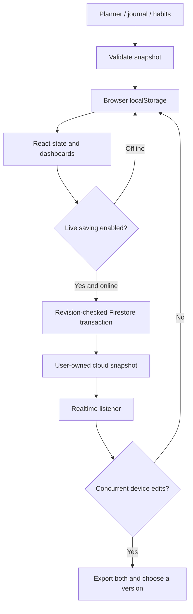

# Architecture

The app is a small local-first React application. Feature folders own their UI and behavior; shared code has no dependency on feature components. Avoid moving unrelated state into global context until multiple screens actually need it.

## Responsibilities

- `app/App.jsx` coordinates the selected date, active view, local persistence, account identity, and backup review. Screens receive explicit props.
- `features/planner` owns task creation, task editing, daily habits, metrics, and copying a previous routine.
- `features/challenge` owns the thirty-day calendar and phases.
- `features/journal` owns the reflection form.
- `features/progress` derives statistics, XP, streaks, levels, and badges. Rewards are calculated, never incremented on checkbox clicks.
- `features/reminders` owns open-app alarms, sound and snooze, phone-registration UI, and standard Web Push subscriptions.
- `features/sync` owns Authentication UI, Firestore backup transactions, and opt-in live synchronization.
- `shared/model/tracker.js` owns schema validation, the challenge start date, default records, and pure date/statistics helpers.
- `shared/services` owns Firebase initialization and browser storage/export adapters.
- `functions` contains the trusted push scheduler. It never reads journal or planner contents.

## Data flow

Local persistence completes before React applies an edit. A failed write keeps the previous visible/saved version and reports a recovery action. Another tab's storage change pauses both editing and cloud sync; prefer one active editing tab per browser profile.

The schema-2 tracker snapshot has a date-keyed `days` map. Each day stores checked habit IDs, timed tasks, walking minutes, sleep/screen hours, wins, and reflection. All dates use the device's local calendar day. The challenge is anchored at 6 November 2026, but the tracker accepts dates outside that challenge.

Cloud storage is `/users/{uid}/app/tracker`. Revisions increase through transactions; server timestamps bind writes to the current request. Live saving keeps an account-specific acknowledged base locally and compares canonical JSON snapshots. Conflicts pause writes and require an explicit version choice. Data remains local while offline; re-enabling live saving after reopening resumes from persisted local edits. Automatic field-level merge and per-record sync are future improvements.

## Notifications

Open-app task reminders use a foreground timer and a user-enabled Web Audio session. They are not reliable background alarms. Standard Web Push uses the service worker for closed-app notifications. Subscription and reminder documents are separate owner-only collections. The scheduled Firebase Function sends generic messages, claims work with leases, retries transient errors, and rejects arbitrary push endpoints.

## Boundaries

- No credentials, real entries, push subscriptions, or exports belong in source control.
- Local entries and sync metadata are unencrypted within the browser profile.
- Enabling live saving explicitly includes journal entries in the private Firebase account.
- The service worker precaches only static app assets and does not cache Firebase API responses.
- The current cloud format is a bounded whole-app snapshot; conflict review takes precedence over silent overwrites.
- Backend deployment, billing setup, secrets, and device permissions are separate from building source.
